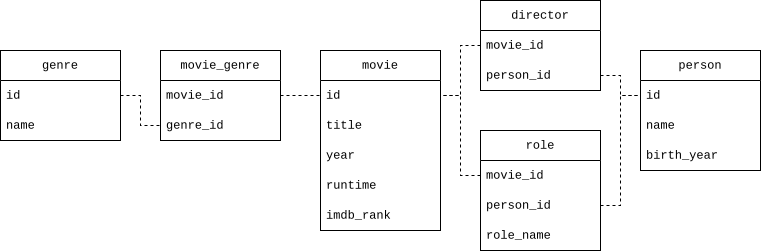

As of Fall 2026



## Sample Queries

From `sample-queries.py`, run with `sqlite3 movies.sqlite` in `.mode box`.

### Top Movies

```sql
SELECT * from movie
order by imdb_rank
limit 10
```

```
┌────┬───────────────────────────────────────────────────┬──────┬─────────┬───────────┐
│ id │                       title                       │ year │ runtime │ imdb_rank │
├────┼───────────────────────────────────────────────────┼──────┼─────────┼───────────┤
│ 1  │ The Shawshank Redemption                          │ 1994 │ 142     │ 1         │
│ 2  │ The Godfather                                     │ 1972 │ 175     │ 2         │
│ 3  │ The Dark Knight                                   │ 2008 │ 152     │ 3         │
│ 4  │ The Godfather Part II                             │ 1974 │ 202     │ 4         │
│ 5  │ The Lord of the Rings: The Return of the King     │ 2003 │ 201     │ 5         │
│ 6  │ 12 Angry Men                                      │ 1957 │ 96      │ 6         │
│ 7  │ Schindler's List                                  │ 1993 │ 196     │ 7         │
│ 8  │ The Lord of the Rings: The Fellowship of the Ring │ 2001 │ 178     │ 8         │
│ 9  │ Pulp Fiction                                      │ 1994 │ 154     │ 9         │
│ 10 │ The Lord of the Rings: The Two Towers             │ 2002 │ 179     │ 10        │
└────┴───────────────────────────────────────────────────┴──────┴─────────┴───────────┘
```

### Old Movies

```sql
SELECT * from movie
order by year
limit 10
```

```
┌─────┬────────────────────────────┬──────┬─────────┬───────────┐
│ id  │           title            │ year │ runtime │ imdb_rank │
├─────┼────────────────────────────┼──────┼─────────┼───────────┤
│ 146 │ The Kid                    │ 1921 │ 68      │ 146       │
│ 213 │ Sherlock Jr.               │ 1924 │ 45      │ 213       │
│ 211 │ The Gold Rush              │ 1925 │ 95      │ 211       │
│ 219 │ The General                │ 1926 │ 78      │ 219       │
│ 123 │ Metropolis                 │ 1927 │ 150     │ 123       │
│ 247 │ The Passion of Joan of Arc │ 1928 │ 114     │ 247       │
│ 56  │ City Lights                │ 1931 │ 87      │ 56        │
│ 115 │ M                          │ 1931 │ 99      │ 115       │
│ 53  │ Modern Times               │ 1936 │ 87      │ 53        │
│ 170 │ Gone with the Wind         │ 1939 │ 238     │ 170       │
└─────┴────────────────────────────┴──────┴─────────┴───────────┘
```

### Movie Count

```sql
SELECT count(*) as num_movies from movie
```

```
┌────────────┐
│ num_movies │
├────────────┤
│ 250        │
└────────────┘
```

### Top Movie Years

```sql
SELECT
    year,
    count(*) as num_movies,
    GROUP_CONCAT(title, ", ") as movies
    from movie
group by year
order by num_movies desc
limit 10
```

```
┌──────┬────────────┬───────────────────────────────────────────────────────────────────────────────────────────────────────────────────────────────────────────────────────────────────────────────────────┐
│ year │ num_movies │                                                                                        movies                                                                                         │
├──────┼────────────┼───────────────────────────────────────────────────────────────────────────────────────────────────────────────────────────────────────────────────────────────────────────────────────┤
│ 2004 │ 8          │ Kill Bill: The Whole Bloody Affair, Eternal Sunshine of the Spotless Mind, Downfall, Howl's Moving Castle, Million Dollar Baby, The Incredibles, Before Sunset, Hotel Rwanda          │
│ 1995 │ 8          │ Seven, The Usual Suspects, Toy Story, Braveheart, Heat, Casino, Before Sunrise, La haine                                                                                              │
│ 2003 │ 7          │ The Lord of the Rings: The Return of the King, Oldboy, Kill Bill: Vol. 1, Finding Nemo, The Best of Youth, Memories of Murder, Pirates of the Caribbean: The Curse of the Black Pearl │
│ 2019 │ 6          │ Parasite, Avengers: Endgame, Joker, 1917, Klaus, Ford v Ferrari                                                                                                                       │
│ 2009 │ 6          │ Inglourious Basterds, 3 Idiots, Up, The Secret in Their Eyes, Mary and Max, Hachi: A Dog's Tale                                                                                       │
│ 1999 │ 6          │ Fight Club, The Matrix, The Green Mile, American Beauty, The Sixth Sense, The Iron Giant                                                                                              │
│ 1957 │ 6          │ 12 Angry Men, Witness for the Prosecution, Paths of Glory, The Bridge on the River Kwai, Wild Strawberries, The Seventh Seal                                                          │
│ 2018 │ 5          │ Avengers: Infinity War, Spider-Man: Into the Spider-Verse, Capernaum, Green Book, Andhadhun                                                                                           │
│ 2015 │ 5          │ Inside Out, Mad Max: Fury Road, Spotlight, Room, Drishyam                                                                                                                             │
│ 2014 │ 5          │ Interstellar, Whiplash, The Grand Budapest Hotel, Gone Girl, Wild Tales                                                                                                               │
└──────┴────────────┴───────────────────────────────────────────────────────────────────────────────────────────────────────────────────────────────────────────────────────────────────────────────────────┘
```

### Decade Stats

```sql
SELECT
    (year / 10) * 10 as decade,
    count(*) as num_movies,
    round(avg(runtime), 1) as avg_runtime,
    round(avg(imdb_rank), 1) as avg_rank,
    movie.title as top_movie
from movie
group by decade
order by decade
```

```
┌────────┬────────────┬─────────────┬──────────┬────────────────────────────────────────────────┐
│ decade │ num_movies │ avg_runtime │ avg_rank │                   top_movie                    │
├────────┼────────────┼─────────────┼──────────┼────────────────────────────────────────────────┤
│ 1920   │ 6          │ 91.7        │ 193.2    │ Metropolis                                     │
│ 1930   │ 6          │ 123.7       │ 143.2    │ Modern Times                                   │
│ 1940   │ 9          │ 119.1       │ 124.3    │ It's a Wonderful Life                          │
│ 1950   │ 21         │ 126.3       │ 135.0    │ 12 Angry Men                                   │
│ 1960   │ 17         │ 145.2       │ 113.6    │ The Good, the Bad and the Ugly                 │
│ 1970   │ 17         │ 136.7       │ 129.0    │ The Godfather                                  │
│ 1980   │ 26         │ 131.7       │ 121.2    │ Star Wars: Episode V - The Empire Strikes Back │
│ 1990   │ 39         │ 126.8       │ 94.4     │ The Shawshank Redemption                       │
│ 2000   │ 48         │ 136.6       │ 124.0    │ The Dark Knight                                │
│ 2010   │ 44         │ 131.4       │ 138.7    │ Inception                                      │
│ 2020   │ 17         │ 142.5       │ 140.7    │ Spider-Man: Across the Spider-Verse            │
└────────┴────────────┴─────────────┴──────────┴────────────────────────────────────────────────┘
```

### Frequent Stars

```sql
SELECT name, count(*) as num_roles from role
join person on person.id = role.person_id
group by person_id
order by num_roles desc
limit 20
```

```
┌────────────────────┬───────────┐
│        name        │ num_roles │
├────────────────────┼───────────┤
│ Robert De Niro     │ 9         │
│ Mark Ruffalo       │ 7         │
│ Harrison Ford      │ 7         │
│ Tom Hanks          │ 6         │
│ Morgan Freeman     │ 6         │
│ Matt Damon         │ 6         │
│ Leonardo DiCaprio  │ 6         │
│ Clint Eastwood     │ 6         │
│ Christian Bale     │ 6         │
│ Charles Chaplin    │ 6         │
│ Willem Dafoe       │ 5         │
│ Toshirō Mifune     │ 5         │
│ Tom Holland        │ 5         │
│ Takashi Shimura    │ 5         │
│ Scarlett Johansson │ 5         │
│ Samuel L. Jackson  │ 5         │
│ Robert Downey Jr.  │ 5         │
│ John Ratzenberger  │ 5         │
│ Don Cheadle        │ 5         │
│ Brad Pitt          │ 5         │
└────────────────────┴───────────┘
```

### Movies per Genre

```sql
SELECT genre.name, count(*) AS num_movies
from genre
join movie_genre on movie_genre.genre_id = genre.id
group by genre.id
order by num_movies desc
```

```
┌───────────┬────────────┐
│   name    │ num_movies │
├───────────┼────────────┤
│ Drama     │ 177        │
│ Adventure │ 65         │
│ Crime     │ 54         │
│ Comedy    │ 43         │
│ Action    │ 42         │
│ Mystery   │ 32         │
│ Thriller  │ 29         │
│ Animation │ 28         │
│ Biography │ 27         │
│ War       │ 24         │
│ Sci-Fi    │ 23         │
│ Romance   │ 21         │
│ Fantasy   │ 18         │
│ Family    │ 12         │
│ History   │ 9          │
│ Horror    │ 7          │
│ Western   │ 6          │
│ Sport     │ 6          │
│ Music     │ 4          │
│ Film-Noir │ 3          │
│ Musical   │ 1          │
└───────────┴────────────┘
```

### Young Stars

```sql
SELECT
  person.name,
  person.birth_year,
  movie.year - person.birth_year as age,
  movie.title, movie.year
  from person
join role on person.id = role.person_id
join movie on movie.id = role.movie_id
where person.birth_year is not null
order by age
limit 10
```

```
┌───────────────────┬────────────┬─────┬───────────────────────────────────────────────┬──────┐
│       name        │ birth_year │ age │                     title                     │ year │
├───────────────────┼────────────┼─────┼───────────────────────────────────────────────┼──────┤
│ Giorgio Cantarini │ 1992       │ 5   │ Life Is Beautiful                             │ 1997 │
│ Mary Gibbs        │ 1996       │ 5   │ Monsters, Inc.                                │ 2001 │
│ Ali Astin         │ 1996       │ 7   │ The Lord of the Rings: The Return of the King │ 2003 │
│ Samantha Mahurin  │ 1999       │ 7   │ The Prestige                                  │ 2006 │
│ Jackie Coogan     │ 1914       │ 7   │ The Kid                                       │ 1921 │
│ Boone Storm       │ 2017       │ 7   │ The Wild Robot                                │ 2024 │
│ Betsy Ann Hisle   │ 1917       │ 7   │ Sherlock Jr.                                  │ 1924 │
│ Ege Tanman        │ 1998       │ 7   │ My Father and My Son                          │ 2005 │
│ Mrunal Jadhav     │ 2008       │ 7   │ Drishyam                                      │ 2015 │
│ Ryûnosuke Kamiki  │ 1993       │ 8   │ Spirited Away                                 │ 2001 │
└───────────────────┴────────────┴─────┴───────────────────────────────────────────────┴──────┘
```

### Old Stars

```sql
SELECT
  person.name,
  person.birth_year,
  movie.year - person.birth_year as age,
  movie.title, movie.year
  from person
join role on person.id = role.person_id
join movie on movie.id = role.movie_id
where person.birth_year is not null
order by age desc
limit 10
```

```
┌────────────────────┬────────────┬─────┬────────────────────────────────────┬──────┐
│        name        │ birth_year │ age │               title                │ year │
├────────────────────┼────────────┼─────┼────────────────────────────────────┼──────┤
│ Alfonso Arau       │ 1932       │ 85  │ Coco                               │ 2017 │
│ Jean Sincere       │ 1919       │ 85  │ The Incredibles                    │ 2004 │
│ Don Rickles        │ 1926       │ 84  │ Toy Story 3                        │ 2010 │
│ Anthony Hopkins    │ 1937       │ 83  │ The Father                         │ 2020 │
│ Ellen Burstyn      │ 1932       │ 82  │ Interstellar                       │ 2014 │
│ Sarita Joshi       │ 1941       │ 82  │ 12th Fail                          │ 2023 │
│ Estelle Harris     │ 1928       │ 82  │ Toy Story 3                        │ 2010 │
│ Haruko Katō        │ 1922       │ 82  │ Howl's Moving Castle               │ 2004 │
│ Christopher Walken │ 1943       │ 81  │ Dune: Part Two                     │ 2024 │
│ Robert Eddison     │ 1908       │ 81  │ Indiana Jones and the Last Crusade │ 1989 │
└────────────────────┴────────────┴─────┴────────────────────────────────────┴──────┘
```

### Frequent Directors

```sql
SELECT person.name, count(*) AS films
from director
join person on person.id = director.person_id
group by person.id
having films >= 3
order by films desc
```

```
┌──────────────────────┬───────┐
│         name         │ films │
├──────────────────────┼───────┤
│ Christopher Nolan    │ 9     │
│ Steven Spielberg     │ 7     │
│ Stanley Kubrick      │ 7     │
│ Martin Scorsese      │ 7     │
│ Quentin Tarantino    │ 6     │
│ Akira Kurosawa       │ 6     │
│ Charles Chaplin      │ 5     │
│ Billy Wilder         │ 5     │
│ Alfred Hitchcock     │ 5     │
│ Sergio Leone         │ 4     │
│ Lee Unkrich          │ 4     │
│ Hayao Miyazaki       │ 4     │
│ Ridley Scott         │ 3     │
│ Peter Jackson        │ 3     │
│ Pete Docter          │ 3     │
│ Joel Coen            │ 3     │
│ James Cameron        │ 3     │
│ Francis Ford Coppola │ 3     │
│ Ethan Coen           │ 3     │
│ Denis Villeneuve     │ 3     │
│ David Fincher        │ 3     │
│ Clint Eastwood       │ 3     │
│ Brad Bird            │ 3     │
└──────────────────────┴───────┘
```

### Directors who Acted

```sql
SELECT person.name, movie.title, GROUP_CONCAT(role_name, ", ") as roles
from director
join role on
    role.movie_id = director.movie_id
    and role.person_id = director.person_id
join person on person.id = director.person_id
join movie on movie.id = director.movie_id
group by person.name, movie.title
```

```
┌───────────────────┬─────────────────────────────────┬──────────────────────────────────────────────────┐
│       name        │              title              │                      roles                       │
├───────────────────┼─────────────────────────────────┼──────────────────────────────────────────────────┤
│ Aamir Khan        │ Like Stars on Earth             │ Ram Shankar Nikumbh                              │
│ Bob Peterson      │ Up                              │ Dug, Alpha                                       │
│ Buster Keaton     │ Sherlock Jr.                    │ Projectionist, Sherlock, Jr.                     │
│ Buster Keaton     │ The General                     │ Johnnie Gray                                     │
│ Charles Chaplin   │ City Lights                     │ A Tramp                                          │
│ Charles Chaplin   │ Modern Times                    │ A Factory Worker                                 │
│ Charles Chaplin   │ The Gold Rush                   │ The Lone Prospector                              │
│ Charles Chaplin   │ The Great Dictator              │ Hynkel - Dictator of Tomania, A Jewish Barber    │
│ Charles Chaplin   │ The Kid                         │ A Tramp                                          │
│ Clint Eastwood    │ Gran Torino                     │ Walt Kowalski                                    │
│ Clint Eastwood    │ Million Dollar Baby             │ Frankie Dunn                                     │
│ Clint Eastwood    │ Unforgiven                      │ Bill Munny                                       │
│ Gene Kelly        │ Singin' in the Rain             │ Don Lockwood                                     │
│ Mel Gibson        │ Braveheart                      │ William Wallace                                  │
│ Orson Welles      │ Citizen Kane                    │ Kane                                             │
│ Quentin Tarantino │ Reservoir Dogs                  │ Mr. Brown                                        │
│ Roberto Benigni   │ Life Is Beautiful               │ Guido                                            │
│ Roman Polanski    │ Chinatown                       │ Man with Knife                                   │
│ Sergio Pablos     │ Klaus                           │ Pumpkin, Olaf                                    │
│ Terry Gilliam     │ Monty Python and the Holy Grail │ Patsy, Green Knight, Knight of Camelot           │
│ Terry Jones       │ Monty Python and the Holy Grail │ Dennis's Mother, Sir Bedevere, Knight of Camelot │
└───────────────────┴─────────────────────────────────┴──────────────────────────────────────────────────┘
```

### Director-Actor Pairs

```sql
SELECT d.name AS director, a.name AS actor, count(*) AS num_movies
from director
join role on role.movie_id = director.movie_id
join person d on d.id = director.person_id
join person a on a.id = role.person_id
where d.id != a.id
group by director.person_id, role.person_id
having num_movies >= 4
order by num_movies desc
```

```
┌───────────────────┬────────────────────┬────────────┐
│     director      │       actor        │ num_movies │
├───────────────────┼────────────────────┼────────────┤
│ Akira Kurosawa    │ Takashi Shimura    │ 5          │
│ Akira Kurosawa    │ Toshirō Mifune     │ 5          │
│ Christopher Nolan │ Christian Bale     │ 5          │
│ Anthony Russo     │ Chadwick Boseman   │ 4          │
│ Anthony Russo     │ Chris Evans        │ 4          │
│ Anthony Russo     │ Don Cheadle        │ 4          │
│ Anthony Russo     │ Mark Ruffalo       │ 4          │
│ Anthony Russo     │ Robert Downey Jr.  │ 4          │
│ Anthony Russo     │ Scarlett Johansson │ 4          │
│ Charles Chaplin   │ Henry Bergman      │ 4          │
│ Christopher Nolan │ Cillian Murphy     │ 4          │
│ Christopher Nolan │ Michael Caine      │ 4          │
│ Ingmar Bergman    │ Bibi Andersson     │ 4          │
│ Joe Russo         │ Chadwick Boseman   │ 4          │
│ Joe Russo         │ Chris Evans        │ 4          │
│ Joe Russo         │ Don Cheadle        │ 4          │
│ Joe Russo         │ Mark Ruffalo       │ 4          │
│ Joe Russo         │ Robert Downey Jr.  │ 4          │
│ Joe Russo         │ Scarlett Johansson │ 4          │
│ Martin Scorsese   │ Robert De Niro     │ 4          │
│ Peter Jackson     │ Sala Baker         │ 4          │
└───────────────────┴────────────────────┴────────────┘
```

## Schema

```
CREATE TABLE movie (
  id INTEGER PRIMARY KEY,
  title TEXT NOT NULL,
  year INTEGER,
  runtime INTEGER,
  imdb_rank INTEGER
);

CREATE TABLE genre (
  id INTEGER PRIMARY KEY,
  name TEXT NOT NULL UNIQUE
);

CREATE TABLE movie_genre (
  movie_id INTEGER NOT NULL REFERENCES movie(id),
  genre_id INTEGER NOT NULL REFERENCES genre(id),
  PRIMARY KEY (movie_id, genre_id)
);

CREATE TABLE person (
  id INTEGER PRIMARY KEY,
  name TEXT NOT NULL,
  birth_year INTEGER
);

CREATE TABLE director (
  movie_id INTEGER NOT NULL REFERENCES movie(id),
  person_id INTEGER NOT NULL REFERENCES person(id),
  PRIMARY KEY (movie_id, person_id)
);

CREATE TABLE role (
  movie_id INTEGER NOT NULL REFERENCES movie(id),
  person_id INTEGER NOT NULL REFERENCES person(id),
  role_name TEXT,
  PRIMARY KEY (movie_id, person_id, role_name)
);
```
